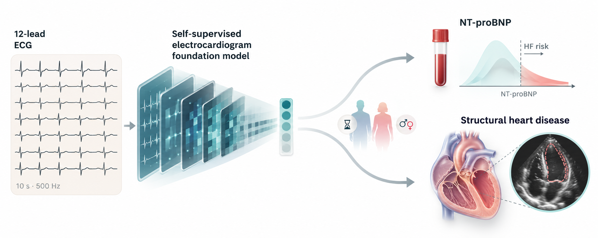
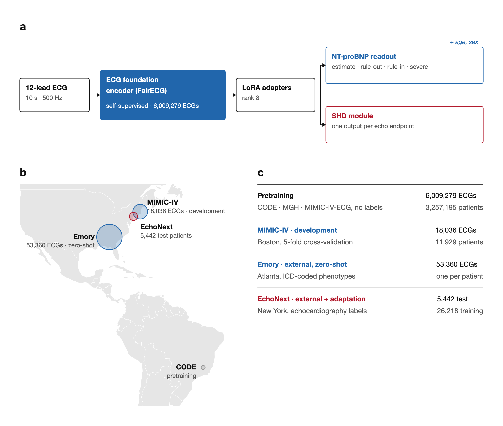
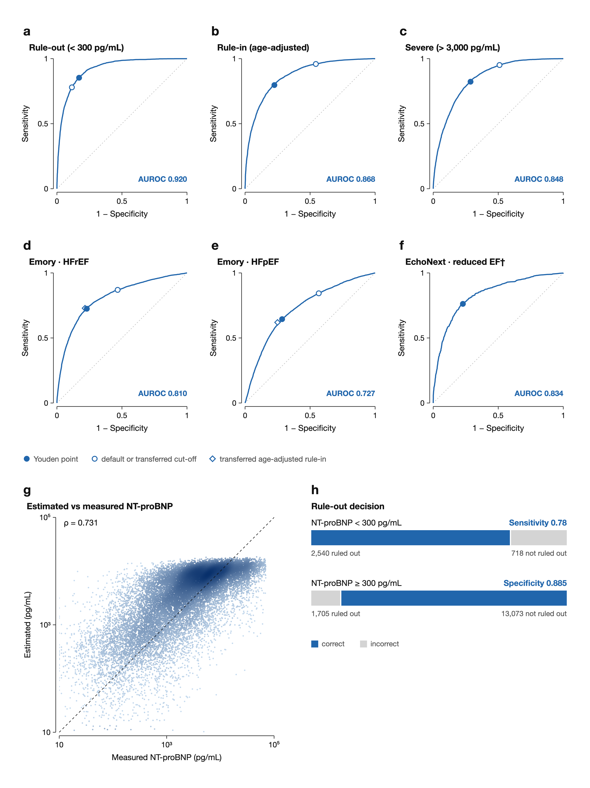
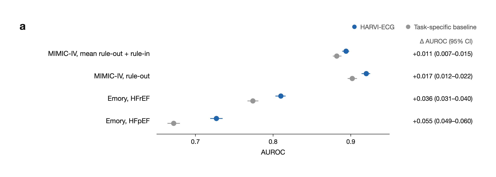
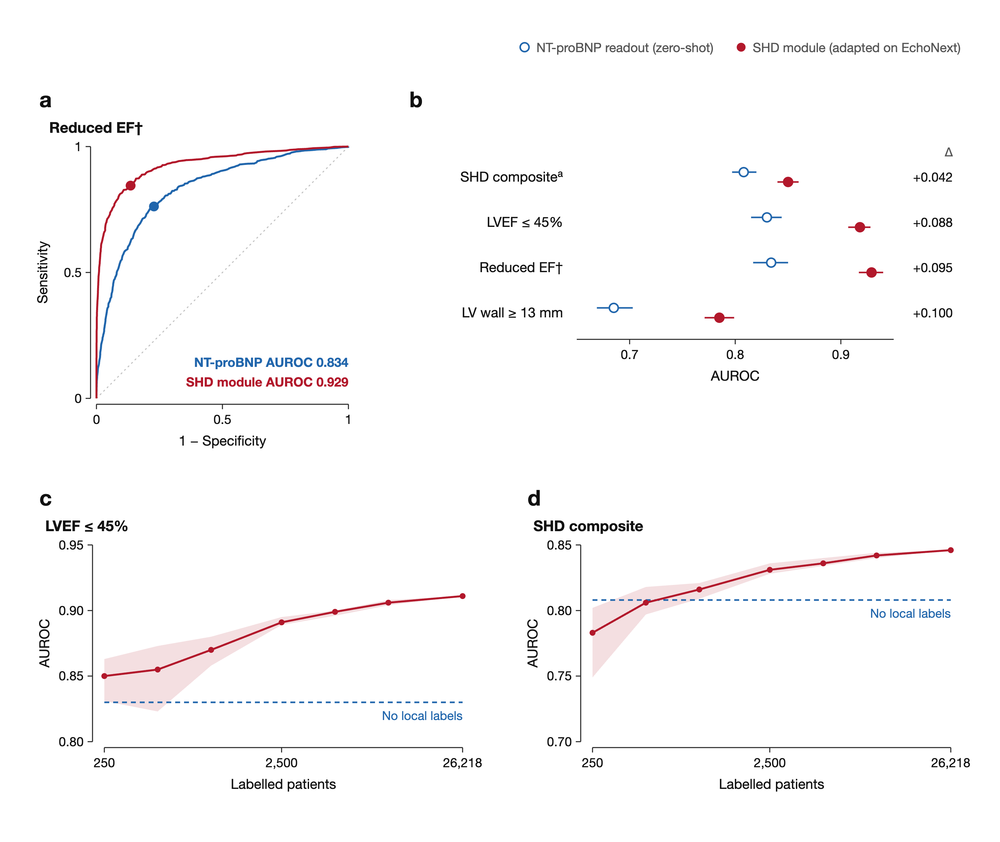
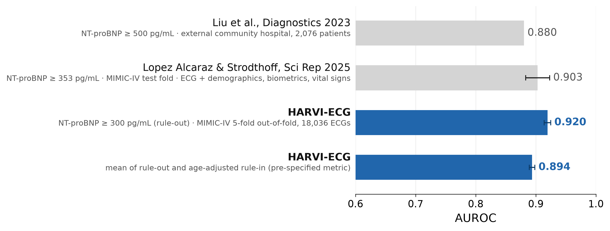

<p align="center">
  
</p>

<p align="center">
  <b>Heart-failure readouts from a standard 10-second 12-lead ECG</b>
</p>

<p align="center">
  <a href="https://cellularsyntax.github.io/harvi-ecg-eval/"><b>Explore the interactive project website →</b></a>
</p>

<p align="center">
  <a href="https://cellularsyntax.github.io/harvi-ecg-eval/"></a>
  <a href="report/harvi_results_report.pdf"></a>
  <a href="https://doi.org/10.5281/zenodo.23367346"></a>
  <a href="https://huggingface.co/maxhaberbusch/HARVI-ECG"></a>
  <a href="docs/preregistration.md"></a>
  <a href="LICENSE"></a>
</p>

---

## Why

Heart failure is often recognised late. NT-proBNP is the guideline blood test for ruling heart failure in or out, and echocardiography confirms structural disease, but neither is done routinely in people without symptoms. A 12-lead ECG is cheap, quick and recorded millions of times a day. **HARVI-ECG** reads heart-failure information out of that ECG, so the patients who need a blood test or an echo can be identified from a recording that already exists.

<p align="center"></p>


## At a glance

| | |
|---|---|
| **Rule out** NT-proBNP < 300 pg/mL (MIMIC-IV, 5-fold out-of-fold) | AUROC **0.920** <sub>(0.914–0.925)</sub> |
| **Detect HFrEF** at a hospital it has never seen (Emory, zero-shot) | AUROC **0.810** <sub>(0.803–0.816)</sub> |
| **Detect reduced ejection fraction** at a second unseen hospital (EchoNext, zero-shot) | AUROC **0.834** <sub>(0.819–0.849)</sub> |
| **Detect reduced ejection fraction** after adaptation on local echo labels (EchoNext held-out test) | AUROC **0.929** <sub>(0.917–0.940)</sub> |
| Echo-labelled patients needed to match the zero-label readout (LVEF ≤ 45 %) | **250** |

## How it works

<p align="center"></p>

- **ECG foundation encoder (FairECG).** An xLSTM-based encoder pretrained without labels (SimDINO) on 6,009,279 ECGs from 3,257,195 patients (CODE, MGH, MIMIC-IV-ECG). It turns a 10-second, 500 Hz, 12-lead ECG into a 1,024-dimensional embedding.
- **NT-proBNP readout.** The encoder is adapted with low-rank adapters (LoRA, rank 8) and feeds a head that also receives age and sex. It outputs an NT-proBNP estimate and three guideline decisions: rule-out (< 300 pg/mL), age-adjusted rule-in (> 450 / 900 / 1,800 pg/mL for < 50 / 50–75 / > 75 years) and severe (> 3,000 pg/mL). Trained on MIMIC-IV only.
- **Structural heart disease (SHD) module.** The same encoder with one output per echocardiographic endpoint, adapted on echo-labelled patients from the target site.

## The NT-proBNP readout works and transfers

<p align="center"></p>

| Cohort | Endpoint | ECGs | AUROC (95 % CI) |
|---|---|---|---|
| MIMIC-IV, 5-fold OOF | Rule-out < 300 pg/mL | 18,036 | **0.920** <sub>(0.914–0.925)</sub> |
| | Rule-in (age-adjusted) | 18,036 | **0.868** <sub>(0.862–0.874)</sub> |
| | Severe > 3,000 pg/mL | 18,036 | **0.848** <sub>(0.841–0.855)</sub> |
| | **Mean rule-out + rule-in** (pre-specified) | | **0.894** <sub>(0.889–0.898)</sub> |
| Emory, zero-shot | HFrEF vs matched controls | 28,135 | **0.810** <sub>(0.803–0.816)</sub> |
| | HFpEF vs matched controls | 25,225 | **0.727** <sub>(0.719–0.735)</sub> |
| EchoNext, zero-shot | Reduced EF † | 4,492 | **0.834** <sub>(0.819–0.849)</sub> |
| | LVEF ≤ 45 % | 5,442 | **0.830** <sub>(0.816–0.844)</sub> |

MIMIC-IV: 18,036 ECGs from 11,929 patients. Patients whose ECG waveforms never entered pretraining (2,423) score similarly: mean rule-out + rule-in **0.897** <sub>(0.887–0.907)</sub>. Emory labels are ICD-10 coded; controls are matched 4:1 on age and sex.

## HARVI-ECG outperforms a task-specific baseline in this evaluation

<p align="center"></p>

On identical patients and folds, HARVI-ECG improves on a CNN-xLSTM trained from scratch for the task: 0.894 vs 0.882 on the pre-specified MIMIC-IV metric (Δ +0.011 <sub>(+0.007 to +0.015)</sub>), and most at an unseen hospital: Emory HFrEF 0.810 vs 0.774 (Δ +0.036 <sub>(+0.031 to +0.040)</sub>), HFpEF 0.727 vs 0.672 (Δ +0.055 <sub>(+0.049 to +0.060)</sub>).

## The SHD module detects structural heart disease with few local labels

<p align="center"></p>

EchoNext held-out test patients (n = 5,442, one ECG each). The SHD module is adapted on EchoNext's echo-labelled training patients; the NT-proBNP readout is applied without any EchoNext labels.

| Endpoint | Cases | NT-proBNP readout (zero-shot) | SHD module (adapted) | Δ |
|---|---|---|---|---|
| Structural heart disease (composite) | 2,318 | **0.808** <sub>(0.796–0.820)</sub> | **0.850** <sub>(0.840–0.860)</sub> | +0.042 |
| LVEF ≤ 45 % | 962 | **0.830** <sub>(0.816–0.844)</sub> | **0.918** <sub>(0.907–0.928)</sub> | +0.088 |
| Reduced EF (LVEF ≤ 40 % vs ≥ 50 %) † | 761 | **0.834** <sub>(0.819–0.849)</sub> | **0.929** <sub>(0.917–0.940)</sub> | +0.095 |
| LV wall thickness ≥ 13 mm | 1,061 | **0.685** <sub>(0.667–0.702)</sub> | **0.785** <sub>(0.771–0.799)</sub> | +0.100 |

A frozen-encoder logistic-regression probe (regularisation chosen on EchoNext's separate validation split) on **250 echo-labelled training patients** matches the zero-label NT-proBNP readout for LVEF ≤ 45 % (1,000 for structural heart disease), and accuracy keeps rising with more labels (0.911 with all 26,218 training patients).

† Post hoc endpoint; LVEF ≤ 45 % is the pre-specified alternative.

## Comparison with published models

<p align="center"></p>

Published values as reported: [Liu et al., *Diagnostics* 2023](https://doi.org/10.3390/diagnostics13172723), NT-proBNP ≥ 500 pg/mL at their external community hospital (AUC 0.880); [Lopez Alcaraz & Strodthoff, *Sci Rep* 2025](https://doi.org/10.1038/s41598-025-26715-5), NT-proBNP ≥ 353 pg/mL on a MIMIC-IV test fold from the ECG with demographics, biometrics and vital signs (0.903). Thresholds, cohorts and inputs differ between studies, so this is not a head-to-head comparison.

## Study design

- **Pre-specified.** The decision metric, statistics and external endpoints were fixed before any scoring ([HARVI pre-specification](docs/preregistration.md), [EchoNext pre-specification](docs/echonext_preregistration.md)). 95 % CIs from a 2,000-draw patient bootstrap; paired differences on identical rows.
- **Patient-level separation.** MIMIC-IV folds are grouped by patient. Emory and EchoNext were used neither in pretraining nor in developing the NT-proBNP readout. EchoNext training and validation patients were used to adapt the SHD module and to choose its operating thresholds; all EchoNext results are on the patient-disjoint held-out test split.
- **Zero-shot means zero-shot.** At Emory and EchoNext the NT-proBNP readout score is applied exactly as trained on MIMIC-IV (mean of the five fold models), with no recalibration. Locally selected operating thresholds (the recalibrated Youden point at Emory; Youden points chosen on the EchoNext validation split) use local labels and are reported separately from the unchanged score. The SHD module is adapted on EchoNext and is not zero-shot.
- **Baseline comparison.** The task-specific baseline (ConvNeXt-1D + xLSTM, trained from scratch on the same folds) also differs in architecture, training recipe and checkpoint selection, so the comparison does not isolate pretraining alone.

## Limitations

- Retrospective data; prospective validation of the screening pathway is the next step.
- Emory phenotypes are ICD-10 based. EchoNext records echo findings but not symptoms, so its positives include symptomatic heart failure as well as asymptomatic structural disease.
- The fixed 300 pg/mL rule-out cut-off needs recalibration at a new site; in this evaluation, the age-adjusted rule-in cut-offs transferred to Emory without it.
- See the [technical report](report/harvi_results_report.pdf) for further limitations: pretraining exposure of MIMIC-IV patients, the raw-scale regression head and one training seed per NT-proBNP fold.

## Repository layout

```
src/        data inventory, external cohorts, model training and inference (numbered in run order)
src/checks/ lead-order / lead-integrity checks and evaluation diagnostics
slurm/      cluster batch scripts (paths parameterised)
scoring/    pre-specified scoring (MIMIC-IV, Emory, EchoNext)
results/    aggregate results only (no patient-level data)
report/     LaTeX technical report: generator, source, figures, PDF
docs/       pre-specifications, README generator, assets
```

## Reproducing

See [REPRODUCE.md](REPRODUCE.md). Scoring is deterministic (seed 0): re-running the scoring scripts on the exported predictions reproduces `results/*.csv`. This README is generated from those tables by `docs/make_readme.py`.

## Data access

No patient-level data, predictions or model weights are distributed. **MIMIC-IV / MIMIC-IV-ECG** and the **Harvard-Emory ECG Database** are credentialed-access datasets on PhysioNet. **EchoNext** is available under its own data-use agreement.

## Links

- Project website: <https://cellularsyntax.github.io/harvi-ecg-eval/>
- Technical report: [report/harvi_results_report.pdf](report/harvi_results_report.pdf)
- Model weights: [Hugging Face, maxhaberbusch/HARVI-ECG](https://huggingface.co/maxhaberbusch/HARVI-ECG), available upon reasonable request (access is reviewed and approved manually)
- Archived release (report, results, code): Zenodo, DOI [10.5281/zenodo.23367346](https://doi.org/10.5281/zenodo.23367346) (resolves once the record is published)
- Pre-specifications: [HARVI](docs/preregistration.md) · [EchoNext](docs/echonext_preregistration.md)

## Citation and licence

See [CITATION.cff](CITATION.cff). Code: MIT ([LICENSE](LICENSE)). Report, figures and aggregate results: CC BY 4.0. Model weights: [HARVI-ECG Model Weights Research Licence](LICENSE_WEIGHTS.md) (non-commercial research only, no clinical use, no redistribution).
